# sdksdk

### AI Engineering · Cybersecurity · Developer Tooling · Automation · Software Engineering

Building **AI developer tools, security software, cross-platform applications and self-hosted platforms** for real technical workflows.

---

## About

Cybersecurity evaluator and software developer working across **AI engineering, offensive security, developer tooling, desktop and mobile applications, networking and systems engineering**.

My focus includes AI-assisted development and agentic workflows, security tooling, automation, and self-hosted infrastructure. I prefer building complete tools — from desktop apps and Android interfaces to operator consoles and network services — rather than isolated scripts.

**Security certifications:** `eJPT` · `eWPT`

**Current interests:** AI coding agents · MCP · local LLMs · security engineering · cross-platform apps · Linux and networking · self-hosted systems

---

# Flagship Project

## [PrAImate](https://github.com/sPROFFEs/PrAImate)

**PrAImate** is a desktop harness and native CLI for AI-assisted development. It brings **Claude Code, OpenClaude, Codex CLI, OpenCode and PrAImate Code** into a unified environment. **PrAImate CLI** also supports self-configured OpenAI-compatible endpoints.

- Multi-CLI coding terminals and chats, with reusable agents and YAML workflows
- PrAImate Studio (integrated Code-OSS / VSCodium environment) and Document Studio
- Skills, MCP integrations and local/remote model routing
- Workspace tooling, permission controls and encrypted application storage
- Headless, scriptable agent execution and optional Git backup
- Linux and Windows releases, with macOS Apple Silicon as a build target

[**Documentation and releases**](https://github.com/sPROFFEs/PrAImate)

---

# Featured Projects

Selected work across **security, software engineering, applications, AI and infrastructure**. Repository badges display live statistics.

## [ClamAV-GUI](https://github.com/sPROFFEs/ClamAV-GUI)

  

Cross-platform **ClamAV desktop frontend for Linux, macOS and Windows**, built in C# and Avalonia UI. Includes scans, quarantine, definition updates, directory monitoring, scheduling and daemon controls.

## [DorkQuery](https://github.com/sPROFFEs/DorkQuery)

  

Drag-and-drop search-query builder for **OSINT and web reconnaissance**. Features reusable operators, GHDB/DorkHub datasets and Google, Bing or DuckDuckGo searching. [Try it online](https://sproffes.github.io/DorkQuery/).

## [Aoede](https://github.com/sPROFFEs/Aoede)

  

Self-hosted **multi-user music platform** built around Navidrome, with personal libraries, shared music storage, discovery, playlists, collaboration, optional federation and web/Android listening.

## [GreyTab](https://github.com/sPROFFEs/GreyTab)

  

Pentesting-oriented **Chromium browser environment** combining a side-panel extension, intercepting proxy, system-tool integration and real-time traffic analysis.

## [Vitreo Launcher](https://github.com/sPROFFEs/vitreo-launcher)

  

**Android 12+ launcher** with glass-inspired themes, an App Library, widgets, Control Center and optional notification island. No account, ads, analytics, root or accessibility service required.

## [StreamVault](https://github.com/sPROFFEs/StreamVault)

  

Self-hosted platform for movies, series and live TV, with multi-user libraries, playback progress, an Android client, offline downloads and **opt-in federation between trusted servers**.

## [m365proxy](https://github.com/sPROFFEs/m365proxy)

  

Unofficial local **OpenAI-compatible proxy for Microsoft 365 Copilot Web**, with browser authentication, named profiles, deterministic routing and optional workspace tools. Not an official Microsoft API.

## [GUEST](https://github.com/sPROFFEs/GUEST)

 

**Gateway User Environment Service Template** — isolated Linux network gateways for labs and infrastructure with **WireGuard, nftables, per-peer ACLs, optional Tor routing and a FastAPI control panel**.

---

# More Projects

<b>Security, Recon & Forensics</b>

| Project | Description |
| :--- | :--- |
| **[cve-parser](https://github.com/sPROFFEs/cve-parser)** | Go-based CVE research, CPE matching and JSON/HTML reports for manual verification. |
| **[DFIR-Forensic-Script](https://github.com/sPROFFEs/DFIR-Forensic-Script)** | Windows live-response scripts for collecting network and system evidence. |
| **[LinuxMemMapper](https://github.com/sPROFFEs/LinuxMemMapper)** | Memory-mapping utility for Volatility 2/3 workflows. |
| **[mitmrouter](https://github.com/sPROFFEs/mitmrouter)** | Linux router setup for IoT traffic-analysis and interception labs. |
| **[WebRecon-multitools](https://github.com/sPROFFEs/WebRecon-multitools)** | Shell scripts and utilities for web reconnaissance. |

<b>AI Integrations & Automation</b>

| Project | Description |
| :--- | :--- |
| **[GPT-webProxy](https://github.com/sPROFFEs/GPT-webProxy)** | Experimental browser-backed ChatGPT Web gateway with a local OpenAI-compatible endpoint and workspace modes. |
| **[AnimeDeskRice](https://github.com/sPROFFEs/AnimeDeskRice)** | Debian/Kali desktop and terminal automation, themes and environment setup. |

<b>Documentation & Browser Extensions</b>

| Project | Description |
| :--- | :--- |
| **[CiberDocs](https://sproffes.github.io/)** ([source](https://github.com/sPROFFEs/sproffes.github.io)) | Cybersecurity notes, technical guides and writeups. |
| **[ProtonVPN Harvester](https://addons.mozilla.org/en-US/firefox/addon/protonvpn-harvester/)** | Firefox extension for ProtonVPN WireGuard configuration exports. |
| **[Workday Payslips Downloader](https://addons.mozilla.org/en-US/firefox/addon/workday-payslips-downloader/)** | Firefox extension to download multiple payslips in a batch. |
| **[PyClicker](https://coresecframe.github.io/PyClicker/)** | Desktop macro and auto-clicker utility. |

<b>Earlier Work & Forks</b>

**[CoreSecFrame](https://github.com/CoreSecFrame/CoreSecFrameWebApp)** — earlier modular cybersecurity framework with web interface and security tooling; no longer a primary development focus.

**[LinuxCatScale](https://github.com/sPROFFEs/LinuxCatScale)** — fork of an incident-response collection and reporting toolkit.

---

# Technology Stack

### Languages

### AI & Agentic Development

### Systems & Infrastructure

### Backend & Data

---

# GitHub Activity

 

<picture>
  <source media="(prefers-color-scheme: dark)" srcset="https://raw.githubusercontent.com/sPROFFEs/sPROFFEs/output/pacman-contribution-graph-dark.svg">
  <source media="(prefers-color-scheme: light)" srcset="https://raw.githubusercontent.com/sPROFFEs/sPROFFEs/output/pacman-contribution-graph.svg">
  
</picture>

---

### Building tools at the intersection of AI, security and software engineering.

 

